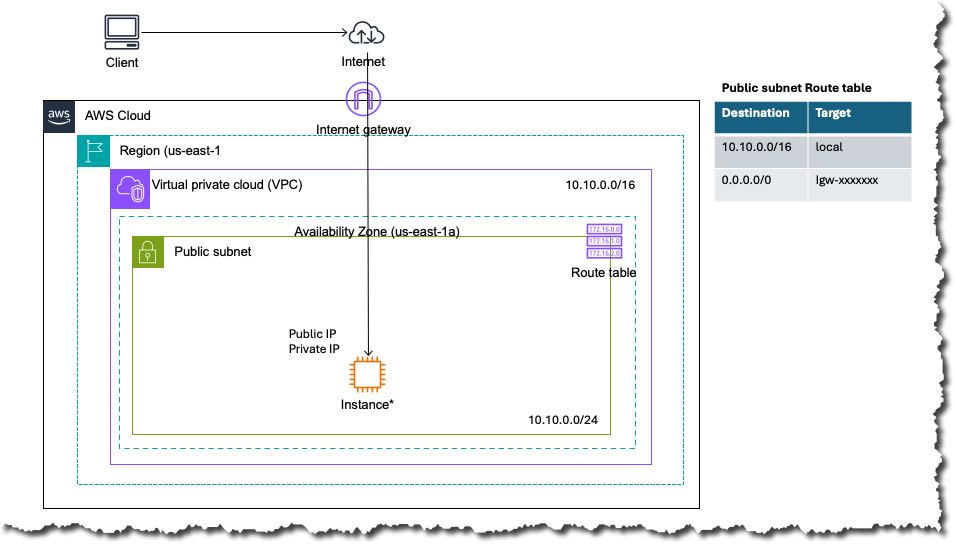

# AWS Networking Lab 01: Public VPC with SSH-Accessible EC2 Instance

<!-- Row 1: Status - Most Important -->
[](https://github.com/subhamay-bhattacharyya/aws-lab01-vpc-single-public-subnet/releases)&nbsp;[](https://github.com/subhamay-bhattacharyya/aws-lab01-vpc-single-public-subnet/actions/workflows/release.yaml)&nbsp;[](https://github.com/subhamay-bhattacharyya/aws-lab01-vpc-single-public-subnet/issues)&nbsp;[](https://github.com/subhamay-bhattacharyya/aws-lab01-vpc-single-public-subnet/commits)

<!-- Row 2: Code Quality -->
[](https://github.com/subhamay-bhattacharyya/aws-lab01-vpc-single-public-subnet)&nbsp;[](https://github.com/subhamay-bhattacharyya/aws-lab01-vpc-single-public-subnet/commits)

<!-- Row 3: Tech Stack -->
[](https://aws.amazon.com/cloudformation/)&nbsp;[](https://claude.ai/)

<!-- Row 4: Repository Info -->
[](https://github.com/subhamay-bhattacharyya/aws-lab01-vpc-single-public-subnet)&nbsp;[](https://github.com/subhamay-bhattacharyya/aws-lab01-vpc-single-public-subnet)&nbsp;[](https://github.com/subhamay-bhattacharyya/aws-lab01-vpc-single-public-subnet/releases)

<!-- Row 5: Custom Metrics -->
[](https://gist.github.com/subhamay-bhattacharyya/9b0a9c7309f6881810bdef55838d5f8f)

---

This lab deploys a VPC with a single public subnet and an EC2 instance that is reachable over SSH from the internet. It is built as a root CloudFormation stack that composes reusable nested stacks.

## Architecture



The diagram shows the default lab values from `cloudformation/parameters.json`:

- **VPC:** `10.10.0.0/16`
- **Public subnet:** `10.10.0.0/20` in Availability Zone `us-east-1a`
- **Internet gateway:** attached to the VPC
- **Route table:** `10.10.0.0/16 → local` and `0.0.0.0/0 → igw-xxxxxx`, associated with the public subnet
- **Security group:** allows inbound SSH from the internet
- **EC2 instance:** launched in the public subnet via the nested EC2 stack (private IP only, since the nested template does not export a public IP)

Traffic path: the EC2 instance sits in the public subnet, whose route table sends traffic through the internet gateway. The security group admits SSH from `0.0.0.0/0`. The root stack exports only the instance's private IP, so SSH from outside the VPC needs a different route to the instance.

## Repository Layout

```text
cloudformation/
├── template.yaml        # Root stack: wires the nested stacks and EC2 instance together
├── parameters.json      # Parameter values used for the lab (dev environment)
└── stack-config.json    # Stack name, template file, and parameter file
media/
└── archiecture-diagram.jpg
.env/
└── environments.yaml    # Environment-to-GitHub-environment mapping and regions
```

## Stacks Created

The root template (`cloudformation/template.yaml`) creates these resources. The first three are nested stacks whose templates are loaded from an S3 bucket.

| Logical name | Type | Nested template (S3 key) | Creates |
| --- | --- | --- | --- |
| `VpcNestedStack` | Nested stack | `cfn-nested-aws-vpc/template.yaml` | VPC with DNS support and hostnames, and an internet gateway |
| `PublicSubnetsNestedStack` | Nested stack | `cfn-nested-aws-subnets/template.yaml` | One public subnet in `us-east-1a` with a default route to the internet gateway |
| `WebSecurityGroupNestedStack` | Nested stack | `cfn-nested-aws-ec2-security-group/template.yaml` | SSH-only security group (inbound TCP 22 from `0.0.0.0/0`) |
| `Ec2Instance` | Nested stack | `cfn-nested-aws-ec2-instance/template.yaml` | EC2 instance in the public subnet, with the web security group and the key pair from `KeyPairName` |

## Parameters

| Parameter | Default | Description |
| --- | --- | --- |
| `NestedStacksS3BucketName` | `subhamay-cfn-templates-bucket-270453428528-us-east-1` | S3 bucket that holds the nested templates |
| `SubnetQualifier` | `public` | Qualifier added to subnet names (only `public` is allowed) |
| `ProjectName` | `networking` | Project name used in resource names (lowercase letters, numbers, hyphens; max 20 characters) |
| `Environment` | `devl` | Deployment environment |
| `VPCCidrBlock` | `10.100.0.0/16` | CIDR block for the VPC |
| `SubnetCidrBlocks` | `10.100.0.0/20` | CIDR block for the public subnet |
| `CiSuffix` | `""` | Optional suffix appended to resource names (used for CI runs) |
| `SSHOnlySecurityGroupBaseName` | `ssh-sg` | Base name for the security group |
| `ImageId` | Latest Amazon Linux 2023 x86_64 AMI | SSM parameter that resolves to the AMI ID |
| `InstanceType` | `t3.micro` | One of `t3.micro`, `t3.small`, `t3.medium`, `t2.micro` |
| `KeyPairName` | — (required) | Name of an existing EC2 key pair for SSH |

The lab values in `cloudformation/parameters.json` override some defaults (for example, `VPCCidrBlock` is `10.10.0.0/16` and `SubnetCidrBlocks` is `10.10.0.0/20`), which matches the diagram.

## Outputs

| Output | Description |
| --- | --- |
| `EC2InstanceId` | ID of the EC2 instance |
| `EC2InstancePrivateIp` | Private IP address of the EC2 instance (the nested EC2 template does not export a public IP) |
| `VpcId` | ID of the VPC |
| `InternetGatewayId` | ID of the internet gateway |
| `PublicSubnet1Arn` | ARN of the public subnet |
| `SSHOnlySecurityGroupId` | ID of the SSH-only security group |
| `SSHOnlySecurityGroupName` | Name of the SSH-only security group |

## Prerequisites

- An AWS account and credentials for the AWS CLI
- An S3 bucket in `us-east-1` containing the four nested templates listed above, and read access for the deploying principal
- An existing EC2 key pair in the target region, for SSH access

## Deploy

```bash
aws cloudformation create-stack \
  --stack-name aws-lab01-vpc-single-public-subnet \
  --template-body file://cloudformation/template.yaml \
  --parameters \
    ParameterKey=ProjectName,ParameterValue=netwoking \
    ParameterKey=Environment,ParameterValue=devl \
    ParameterKey=VPCCidrBlock,ParameterValue=10.10.0.0/16 \
    ParameterKey=SubnetCidrBlocks,ParameterValue=10.10.0.0/20 \
    ParameterKey=KeyPairName,ParameterValue=<your-key-pair-name> \
  --region us-east-1

aws cloudformation wait stack-create-complete \
  --stack-name aws-lab01-vpc-single-public-subnet \
  --region us-east-1
```

Get the private IP (reachable only from inside the VPC) and connect:

```bash
PRIVATE_IP=$(aws cloudformation describe-stacks \
  --stack-name aws-lab01-vpc-single-public-subnet \
  --query 'Stacks[0].Outputs[?OutputKey==`EC2InstancePrivateIp`].OutputValue' \
  --output text \
  --region us-east-1)

ssh -i <path-to-key>.pem ec2-user@$PRIVATE_IP
```

## Clean Up

```bash
aws cloudformation delete-stack \
  --stack-name aws-lab01-vpc-single-public-subnet \
  --region us-east-1
```

## License

MIT
